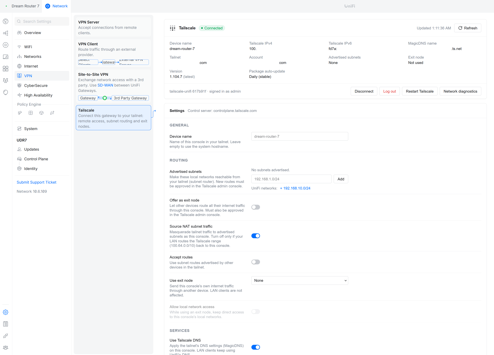

# Web UI panel (experimental)



The package can optionally add a Tailscale card to UniFi Network's VPN
settings, below VPN Server, VPN Client and Site-to-Site VPN. Selecting the
card opens a panel in the right-hand pane where you can:

- see connection state, Tailscale IPs, MagicDNS name, tailnet, account,
  version and health warnings
- connect, disconnect, log in and out, restart Tailscale, run
  `tailscale netcheck`, and update or install Tailscale
- set the device name, advertised subnets (with your UniFi networks offered as
  suggestions), exit node use and advertisement, LAN access while using an
  exit node, accept routes, Tailscale DNS, Tailscale SSH, the Tailscale web
  interface, shields up, SNAT for subnet routes, and automatic updates
- list the devices in the tailnet with their IPs, status, connection type and
  traffic

UniFi administrators can change settings. Users with read-only access to
UniFi Network can view the panel. Other users get an error.

It has been tested on a UDR7 with UniFi OS 6.0.17 (unifi-core 6.0.130) and
UniFi Network 10.6. On consoles whose nginx layout differs, `ui-patch.sh`
does not install the snippet and `manage.sh ui status` says why.

## Installing

The panel is not installed unless you ask for it:

```sh
TAILSCALE_UI=true ./install.sh       # new install, or upgrade, with the panel
```

Without `TAILSCALE_UI=true` the installer removes the panel's files from
`/data/tailscale`. On an upgrade of a console where the panel is already
enabled, it is kept.

Once installed:

```sh
/data/tailscale/manage.sh ui enable    # turn the panel on
/data/tailscale/manage.sh ui status    # show whether it is active, and if not, why
/data/tailscale/manage.sh ui disable   # turn it off and remove its units
```

## Turning it off

| Scope | How |
|---|---|
| One browser | Add `?tsui=off` to a UniFi URL. `?tsui=on` turns it back on. |
| The console | `touch /data/tailscale/ui.disabled`, or `manage.sh ui disable` |

Restarting unifi-core or nginx also removes the nginx snippet. It is added
again afterwards unless `ui.disabled` exists or the panel is disabled.

`TAILSCALE_UI_REQUIRE_OPTIN="true"` in `tailscale-env` limits the card to
browsers that have opened a UniFi URL with `?tsui=on`. This is useful for
trying a new version in one browser first.

## Files on the console

| Path | Purpose |
|---|---|
| `/data/tailscale/ui/` | Backend (`server/`, Node.js) and panel files (`web/`) |
| `/data/tailscale/ui-patch.sh` | Installs and removes the nginx snippet |
| `/data/tailscale/tailscale-env` | `TAILSCALE_UI` and `TAILSCALE_UI_REQUIRE_OPTIN` |
| `/etc/systemd/system/tailscale-unifi-ui.service` | Runs the backend |
| `/etc/systemd/system/tailscale-unifi-ui-patch.{service,path,timer}` | Run `ui-patch.sh apply` after unifi-core starts, when UniFi rewrites its nginx snippets, and every 15 minutes |
| `/run/tailscale-unifi/ui.sock` | Backend socket, `root:nginx`, mode 0660 |
| `/data/unifi-core/config/http/shared-runnable-tailscale-unifi.conf` | The nginx snippet |

No files that belong to UniFi OS are changed, and the backend does not listen
on a TCP port.

## How it works

UniFi OS generates its nginx configuration into `/data/unifi-core/config/http/`.
The main server block includes `shared-runnable-*.conf` from that directory,
which UniFi itself uses for its apps. unifi-core and nginx both empty the
directory when they start.

`ui-patch.sh` places one file there with two locations:

- `location ^~ /proxy/tailscale-unifi/` proxies to the backend's Unix socket.
  For every API request the backend calls UniFi's `GET /api/users/self` with
  the caller's session cookie to find out who they are and whether they are an
  administrator.
- `location = /index.html` serves the UniFi OS portal page from the same
  directory and with the same headers as UniFi's own location, with one
  `<script>` tag added. If the script fails to load, the page works as normal.

`ui-patch.sh apply` installs the snippet only if:

1. the nginx layout matches what it expects (include globs, portal root, no
   location that conflicts with the snippet), the console is set up, and the
   backend is answering
2. the current config passes `nginx -t` and some UniFi URLs give the same
   status codes twice in a row
3. `nginx -t` passes on a copy of the config tree with the snippet added
4. `nginx -t` passes on the live config after the snippet is moved into place
5. after `nginx -s reload`, the same UniFi URLs give the same status codes as
   before, and the panel is reachable

If step 4 or 5 fails, the snippet is removed, nginx is reloaded, and apply
waits an hour before trying again (`manage.sh ui apply` retries immediately).
When the snippet is already in place, apply runs `nginx -t` only if one of
the nginx config files changed since the last check that passed, and removes
the snippet if it fails. A run where nothing changed only reads files, so the
periodic checks do not write to flash. `ui-patch.sh` only deletes files that
start with its own marker line.

The script on the page (`inject.js`) does not depend on UniFi's class names,
which change between builds. It finds the card list by its
`/settings/vpn/<name>` links, finds the content pane by its position next to
the list, reads the theme from `body[data-theme]`, and builds the Tailscale
card by copying UniFi's Site-to-Site card. It does not move or remove UniFi's
elements. If the page does not look as expected, or the copied card renders
at an unexpected size, it adds nothing. In the browser console,
`__tailscaleUnifiUI.status()` shows what it found and why it did or did not
add the card.

The panel itself is an iframe. Updates and installs started from the panel
run in a separate systemd unit, so apt is not interrupted if the backend
restarts.

The backend is about 1,000 lines of JavaScript using only Node.js built-in
modules. It runs on the Node.js runtime that UniFi OS ships for its own
services (`/usr/bin/node24` on UniFi OS 6); `ui/start.sh` picks the newest
one. If UniFi OS stops shipping a runtime, the backend does not start and the
panel stays off. It uses the `tailscale` CLI rather than Tailscale's LocalAPI
because the CLI is installed with tailscaled and always matches its version.

## Development

The panel can be developed without a console. The tests need Node.js 18 or
later; the backend itself also runs on Node.js 16.

```sh
node --test tests/ui/*.test.js
./tests/run.sh                  # includes tests/ui.test.sh

# Panel with simulated Tailscale data at http://127.0.0.1:8099/
node package/ui/server/main.js --listen 127.0.0.1:8099 --mock --dev-noauth
```

Two tests use files copied from a real console. Keep those in the
git-ignored `tests/e2e/fixture/` directory.

```sh
# ui-patch.sh against nginx running the console's UniFi web config (Docker)
tests/e2e/capture-fixture.sh <console-ssh-host>
tests/e2e/run.sh

# inject.js against the VPN settings page. Save the page with DevTools
# (copy(document.documentElement.outerHTML)) as tests/e2e/fixture/browser/vpn-dom.html
python tests/browser/build_harness.py tests/e2e/fixture/browser/vpn-dom.html tests/e2e/fixture/browser
node package/ui/server/main.js --listen 127.0.0.1:8099 --mock --dev-noauth \
  --dev-harness tests/e2e/fixture/browser/harness-real.html
# Open http://127.0.0.1:8099/network/default/settings/vpn/server
# The results are shown at the bottom of the page.
```

`--dev-noauth` and `--dev-harness` are only accepted together with `--listen`
on a loopback address.
